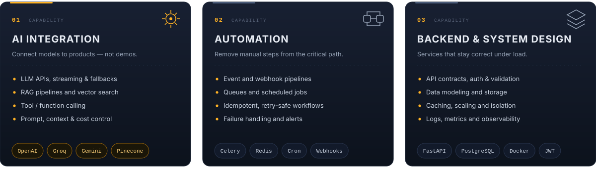

  

 

  <picture>
    <source media="(prefers-color-scheme: dark)" srcset="./assets/ticker.svg"/>
    <source media="(prefers-color-scheme: light)" srcset="./assets/ticker-light.svg"/>
    
  </picture>

 

 

 

 

 

 

 

> **How I think about it:** validate at the edge, enqueue the slow work, isolate every AI provider behind a contract, make retries idempotent, persist the result, and instrument the whole path.

 

 

 

 

  

 

 

<picture>
  <source media="(prefers-color-scheme: dark)" srcset="./assets/github-contribution-grid-snake-dark.svg"/>
  <source media="(prefers-color-scheme: light)" srcset="./assets/github-contribution-grid-snake.svg"/>
  
</picture>

 

